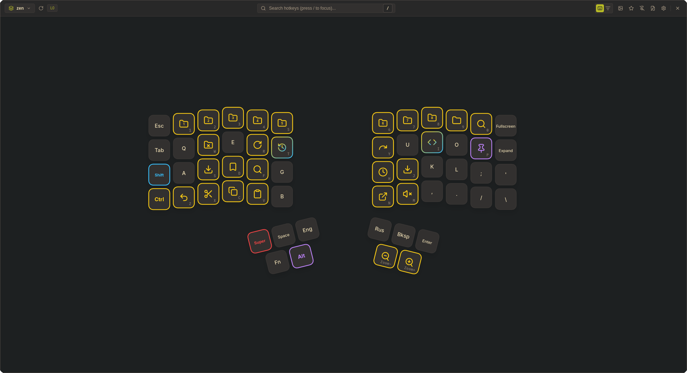

<p align="center">
  
</p>

# korob

Fast, interactive graphical cheatsheet overlay and hotkey catalog for active Wayland windows, built with Rust, Tauri v2, Svelte 5, and Tailwind CSS v4.



## Overview

`korob` displays context-aware hotkeys and command references for the currently focused application on Linux Wayland. It pairs an interactive graphical keyboard canvas—designed for ergonomic split keyboards like Dactyl Manuform as well as standard layouts—with a categorized catalog view. Shortcuts, layouts, and appearance settings are configured declaratively via human-readable YAML files or directly through the graphical user interface.

## Key Features

- **Interactive Graphical Keyboard Canvas**: Full SVG layout renderer supporting complex geometries, columnar staggering, angled thumb clusters, and multi-layer switching (`L0`, `L1`).
- **Wayland Window Tracking**: Queries compositor IPC to detect active window changes, automatically loading matching application shortcuts with quick manual switching between running windows.
- **Dynamic Modifier Gradients**: Highlights keys based on active modifiers (Ctrl, Alt, Shift, Super) and generates multi-stop SVG linear gradients for multi-modifier combinations (e.g. Alt+Shift or Ctrl+Alt).
- **Custom Modifiers**: Define arbitrary modifier keys (`hyper`, `fn`, `leader`) with custom hex colors via GUI or configuration file.
- **GUI Key Action Editor**: Click any keycap on the canvas to configure commands, descriptions, categories, modifiers, and icons with instant persistence.
- **Custom Icon Library**: Manage icon assets in `~/.local/share/korob/icons/`. Paste images directly from the clipboard (<kbd>Ctrl+V</kbd>), import files from disk, or clean unused assets.
- **Declarative YAML Storage**: Clean human-readable YAML cheatsheets stored in `~/.config/korob/shortcuts/<app_id>.yaml` with a built-in full-height YAML editor.
- **Typography Controls**: Choose font families (`Inter`, `JetBrains Mono`, `Fira Code`, system fonts) and adjust UI font size from 11px to 18px with immediate live preview.
- **Theme Presets & Custom Themes**: 8 built-in themes (Gruvbox Dark/Light, Monokai, Catppuccin Mocha/Latte, Dracula, Solarized Dark/Light) matching `kfont`, alongside a custom theme editor.
- **Window Management**: Pin window always-on-top, dismiss with <kbd>Esc</kbd>, and focus search immediately by pressing <kbd>/</kbd>.

## Configuration

Settings are saved declaratively to `~/.config/korob/config.yaml`:

```yaml
version: 1

theme:
  active: "gruvbox-dark"

font:
  family: "Inter, system-ui, sans-serif"
  size: 13

active_layout: "dactyl_manuform"
active_layer: 0
view_mode: "keyboard" # "keyboard" or "list"

modifiers:
  ctrl:
    name: "Ctrl"
    color: "#facc15"
  alt:
    name: "Alt"
    color: "#c084fc"
  shift:
    name: "Shift"
    color: "#38bdf8"
  super:
    name: "Super"
    color: "#f87171"
  hyper:
    name: "Hyper"
    color: "#ec4899"

behavior:
  always_on_top: false
  shortcuts_dir: "~/.config/korob/shortcuts"
  layouts_dir: "~/.config/korob/layouts"
  icons_dir: "~/.local/share/korob/icons"

favorites: []
learned: []
```

### Cheatsheet Format

Cheatsheets are stored in `~/.config/korob/shortcuts/<app_id>.yaml`:

```yaml
app_id: "zen"
name: "Zen Browser"
description: "Zen Browser Hotkeys"
shortcuts:
  - id: "zen-new-tab"
    command: "New Tab"
    description: "Open a new tab in active workspace"
    keys: "ctrl+t"
    category: "Tabs & Navigation"
    icon: "plus"

  - id: "zen-reopen-tab"
    command: "Reopen Closed Tab"
    description: "Restore previously closed browser tab"
    keys: "ctrl+shift+t"
    category: "Tabs & Navigation"
    icon: "history"
```

## Compositor Keybinding

To toggle `korob` with a global hotkey in Umbriel, add a binding to `~/.config/umbriel/config.toml`:

```toml
[keybinds]
"Mod+Slash" = { action = "spawn /home/koresent/.local/bin/korob", repeat = false }
```

## Building from Source

### Prerequisites

- Node.js (v20+) and `npm`
- Rust toolchain (stable)
- Linux libraries:
  ```bash
  sudo apt-get install -y pkg-config build-essential libssl-dev libgtk-3-dev libwebkit2gtk-4.1-dev libayatana-appindicator3-dev librsvg2-dev
  ```

### Development

```bash
# Install frontend dependencies
npm install

# Run application in development mode
npm run tauri dev
```

### Production Build

```bash
npm run tauri build
```

Generated release artifacts:
- Binary: `src-tauri/target/release/korob`
- Debian package: `src-tauri/target/release/bundle/deb/*.deb`
- RPM package: `src-tauri/target/release/bundle/rpm/*.rpm`
- AppImage: `src-tauri/target/release/bundle/appimage/*.AppImage`
